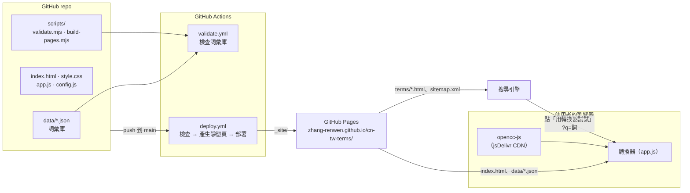
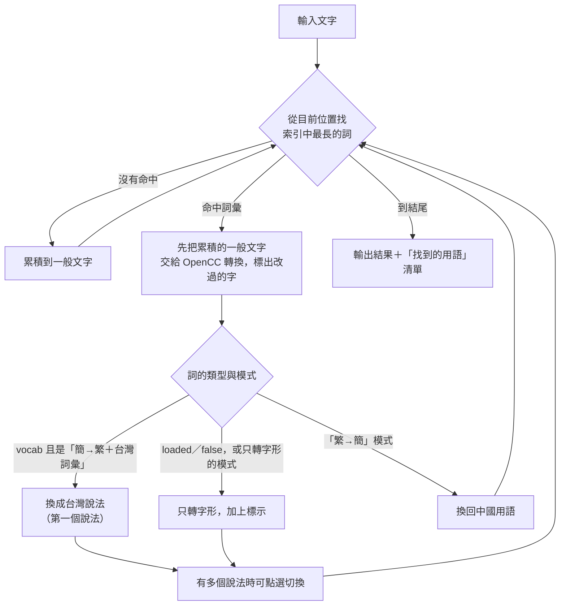
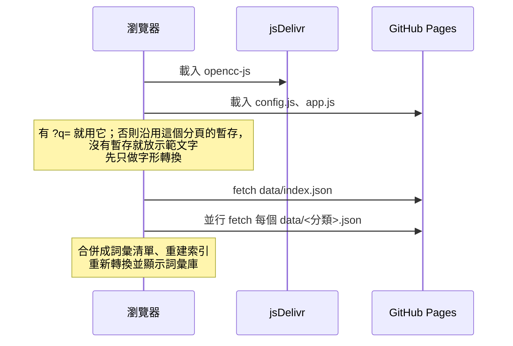
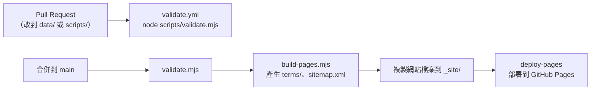

# 技術與架構

這份文件說明網站用了哪些技術、各個檔案怎麼分工，以及一段文字從輸入到轉換結果經過哪些步驟。想新增詞彙請看 [CONTRIBUTING.md](../CONTRIBUTING.md)。

## 使用的技術

| 層面 | 技術 | 用途 |
| --- | --- | --- |
| 頁面 | 純 HTML、CSS、原生 JavaScript | 沒有框架、沒有打包工具，`app.js` 是一個 IIFE，直接用 `<script>` 載入 |
| 字形轉換 | [opencc-js](https://github.com/nk2028/opencc-js) 1.0.5（jsDelivr CDN） | 簡體、台灣正體、香港繁體之間的字形轉換，在瀏覽器內完成 |
| 詞彙庫 | `data/*.json` | 每個分類一個檔案，由 `data/index.json` 列出要載入的檔案與版本 |
| 字型 | Google Fonts（Noto Serif TC、Noto Sans TC） | 標題與內文字型 |
| 檢查 | Node.js 20（`scripts/validate.mjs`） | 檢查詞彙檔格式、必填欄位、類型與重複詞，不需要安裝套件 |
| 靜態頁產生 | Node.js 20（`scripts/build-pages.mjs`） | 每個詞產生一頁 `terms/<詞>.html`，另外產生總表與 `sitemap.xml`，供搜尋引擎收錄 |
| CI／部署 | GitHub Actions、GitHub Pages | PR 自動檢查；合併到 `main` 後產生靜態頁並部署 |
| SEO | `canonical`、Open Graph、JSON-LD（`DefinedTerm`／`DefinedTermSet`） | 讓每個詞彙頁可以被搜尋到 |
| 統計 | Google Analytics（gtag） | 網站流量統計，詞彙頁沿用 `index.html` 裡的同一組 ID |
| 暫存 | `sessionStorage` | 只在同一個瀏覽器分頁內記住原文、模式與目前分頁；關掉分頁就清空，讀不到時照常運作 |

整個網站沒有後端與資料庫，也不需要 `npm install`，Node.js 只用在 CI。

## 整體架構



## 檔案分工

```
index.html                 轉換器與詞彙庫兩個分頁的版面、SEO 標籤、GA
style.css                  轉換器與詞彙頁共用的樣式
app.js                     轉換、詞彙比對、詞彙庫列表、提議表單
config.js                  GitHub repo 名稱與分支（編輯連結、靜態頁網址都由它推出）
data/index.json            詞彙庫版本與要載入的檔案清單
data/<分類>.json           { category, terms: [{ cn, tw, kind, note?, oneway? }] }
scripts/validate.mjs       檢查詞彙檔
scripts/build-pages.mjs    產生 terms/ 與 sitemap.xml（不進 git）
.github/workflows/         validate.yml、deploy.yml
```

### 詞彙資料格式

| 欄位 | 必填 | 說明 |
| --- | --- | --- |
| `cn` | 是 | 中國用語，比對時會同時收簡體與繁體寫法 |
| `tw` | `vocab` 必填 | 台灣說法，多個用「、」分隔，第一個是預設替換 |
| `kind` | 是 | `vocab` 一般用語、`loaded` 評價意涵、`false` 同字異義 |
| `note` | 否 | 說明，顯示在提示與詞彙頁 |
| `oneway` | 否 | `true` 時「繁→簡」模式不反向替換 |

## 轉換流程

使用者每輸入一次，`render()` 就重新跑一次下面的流程。



幾個實作重點：

- **比對索引**：`buildMatcher()` 以詞的第一個字當 key，候選詞依長度由長到短排序，所以長詞優先（例如「菠蘿麵包」會先於「菠蘿」）。模式或詞彙數量改變時才重建。
- **台／臺**：轉成台灣繁體時，OpenCC 轉出的「臺」一律改成「台」；原文本來就寫「臺」的地方先用佔位字保護，保留不動。
- **字形差異標示**：`diffHtml()` 逐字比對轉換前後，長度不同時在小範圍內找回同步點。
- **點選其他說法**：使用者選的說法用「詞#第幾次出現」記住，原文或模式改變就清空。

## 四種轉換模式

| 模式 | OpenCC 設定 | 詞彙庫的處理 |
| --- | --- | --- |
| 簡→繁＋台灣詞彙（預設） | `cn → twp` | `vocab` 直接替換，`loaded`／`false` 只標示 |
| 簡→繁 | `cn → tw` | 全部只標示，不替換 |
| 香港字形 | `cn → hk` | 全部只標示 |
| 繁→簡 | `tw → cn` | 把台灣說法換回中國用語，跳過 `oneway` 的詞 |

## 啟動順序



詞彙庫用 `cache: 'no-cache'` 讀取，合併 PR 後不會讀到舊資料。詞彙庫載入失敗時仍可做字形轉換；直接雙擊開檔（`file://`）讀不到 JSON，頁面會提示改用本機伺服器。

## CI 與部署



- `deploy.yml` 需要 repo 的 **Settings → Pages → Source** 設成 **GitHub Actions**。
- `terms/` 與 `sitemap.xml` 每次部署時重新產生，不進 git。
- 靜態頁的網址前綴由 `config.js` 的 `repo` 推出：`Owner/name` → `https://owner.github.io/name/`。
